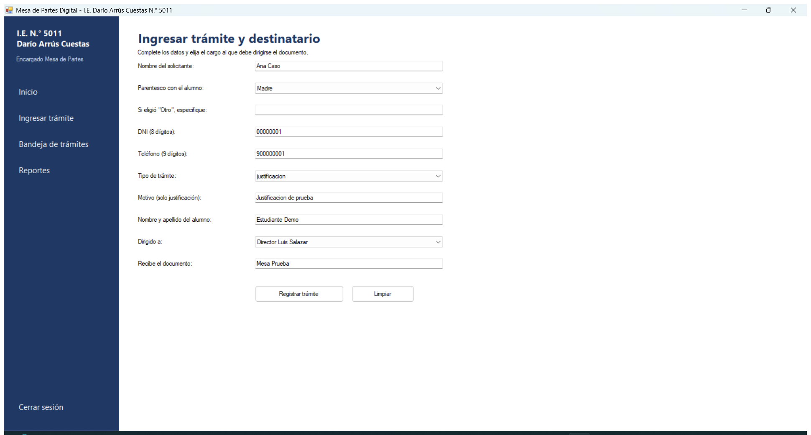
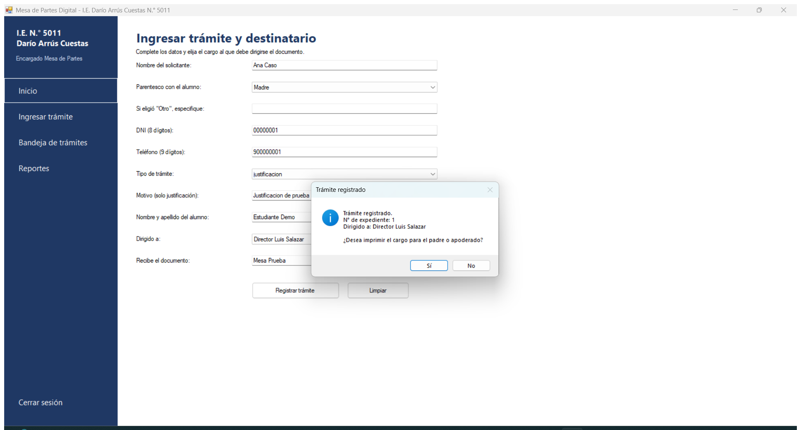
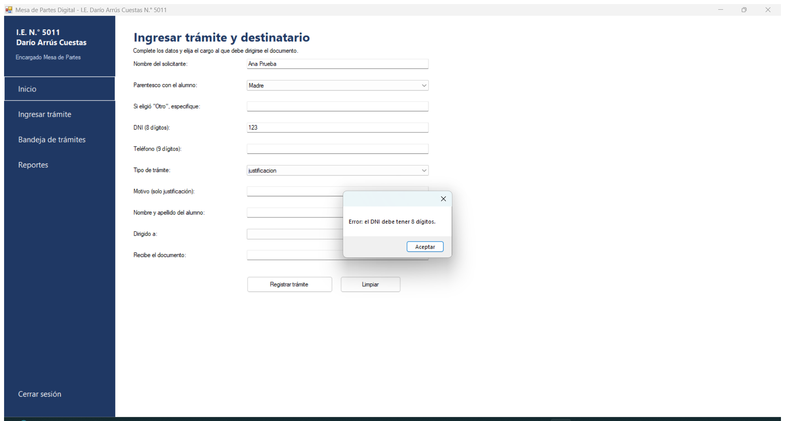
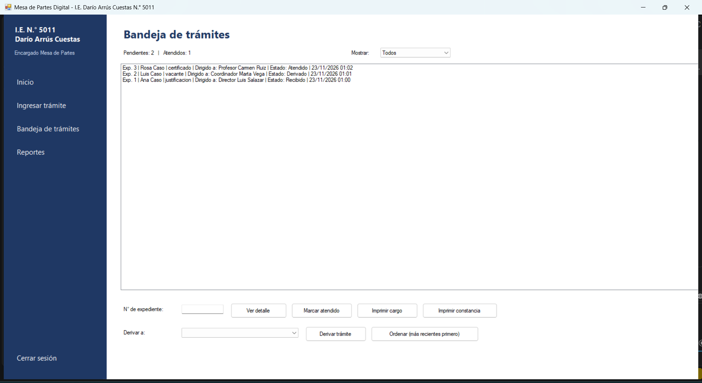
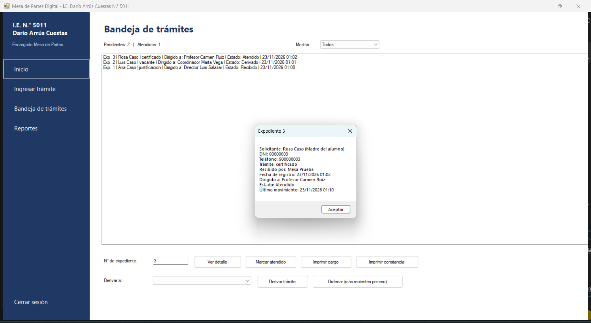

# Punto 6: pruebas con datos y reflexión

## Alcance y datos utilizados

Se ejecutaron pruebas funcionales sobre el prototipo y se capturaron sus pantallas. El informe de avance del grupo sí documenta la observación: recepción de solicitudes FUT y solicitudes simples, justificaciones de inasistencia, registro físico y Excel, derivación física, seguimiento por expediente, aproximadamente 1,200 expedientes acumulados y cerca de 50 documentos recibidos al día. Sin embargo, no incluye filas anonimizadas de expedientes observados que se puedan ingresar literalmente al prototipo.

Por esa razón, los ejemplos de prueba usan identidades, DNI y teléfonos **ficticios**, y reproducen los tipos y el flujo de trámites descritos en la observación; no se presentan como expedientes reales. Las pruebas gráficas se hicieron en una copia aislada de la aplicación para no alterar los datos del sistema principal.

## Casos ejecutados y resultados

| Caso | Entrada o acción | Resultado esperado | Resultado |
|---|---|---|---|
| 1. Validación de nombre | `Ana Ejemplo` y `Ana123` | Aceptar el primero y rechazar el segundo | Correcto |
| 2. Validación de DNI | `00000001` y `123` | Aceptar ocho dígitos y rechazar longitud incorrecta | Correcto |
| 3. Validación de teléfono | `900000001` y `800000001` | Aceptar nueve dígitos que comienzan en 9 y rechazar el otro | Correcto |
| 4. Registro | Tres expedientes ficticios dirigidos a distintas cuentas | Registrar y asignar números correlativos | Correcto |
| 5. Búsqueda interna | Expediente existente y número inexistente | Mostrar el detalle del existente e informar que el otro no existe | Correcto |
| 6. Consulta ciudadana | Número y DNI coincidentes; después, DNI incorrecto | Mostrar el seguimiento solo con los datos coincidentes | Correcto |
| 7. Privacidad de la consulta | Revisar el texto de seguimiento | No incluir el DNI ni el teléfono | Correcto |
| 8. Ordenamiento | Ordenar los tres expedientes registrados | Mostrar primero el número más reciente y conservar juntos los datos de cada registro | Correcto |
| 9. Derivación | Derivar el expediente 1 del director a coordinación | Cambiar el destinatario y el estado a «Derivado» | Correcto |
| 10. Atención y persistencia | Marcar el expediente 1 como atendido y recargar el archivo | Conservar estado y datos relacionados después de recargar | Correcto |

**Resultado de la batería reproducible:** 21 comprobaciones aprobadas de 21 ejecutadas. Además, se probaron en memoria los seis nombres de pila proporcionados en la conversación: los seis pasaron la validación de nombres. Estos nombres no se copiaron a este informe ni al código. Ese dato adicional no representa expedientes completos ni sustituye las pruebas con los demás campos observados.

No se detectaron errores en los recorridos ejecutados y, por tanto, no fue necesario modificar la lógica existente. La batería de 21 comprobaciones es reproducible desde [`pruebas/Punto6Pruebas.cs`](./pruebas/Punto6Pruebas.cs).

## Capturas de los casos ejecutados

Las siguientes capturas muestran recorridos de la aplicación con datos de demostración ficticios. La tabla incluye entradas, resultado observado y evidencia, como se indicó para la presentación de las pruebas.

| Caso | Entrada/acción | Resultado observado | Evidencia |
|---|---|---|---|
| Registro | Registrar una justificación ficticia, con solicitante, estudiante, motivo y destinatario | El sistema asignó el expediente 1 y mostró la confirmación de registro |   |
| Validación de DNI | Ingresar `123` en el campo DNI | El sistema rechazó el registro e indicó que el DNI debe tener ocho dígitos |  |
| Ordenamiento | Ordenar tres expedientes de prueba | La bandeja quedó en orden descendente: 3, 2, 1 |  |
| Búsqueda | Consultar el expediente ficticio 3 | Se mostró el detalle, ubicación y estado «Atendido» del expediente |  |

Para repetirla en Windows, compila primero la aplicación y luego ejecuta desde la carpeta del proyecto:

```powershell
$testDir = Join-Path $env:TEMP 'Punto6Pruebas'
New-Item -ItemType Directory -Force -Path $testDir | Out-Null
Copy-Item '.\bin\Debug\colegio_dario_arrus.exe' $testDir
& "$env:WINDIR\Microsoft.NET\Framework64\v4.0.30319\csc.exe" `
  /nologo "/out:$testDir\Punto6Pruebas.exe" `
  "/reference:$testDir\colegio_dario_arrus.exe" `
  /reference:System.Windows.Forms.dll /reference:System.Drawing.dll `
  '.\pruebas\Punto6Pruebas.cs'
& "$testDir\Punto6Pruebas.exe"
```

Los archivos que genera la prueba quedan en la carpeta temporal aislada, no en la carpeta de datos de la aplicación.

## Reflexión técnica

Las pruebas muestran que el prototipo puede validar campos básicos, generar expedientes correlativos, localizar registros, ordenar los arreglos paralelos sin separar los datos de un mismo trámite y mantener los cambios al guardar y volver a cargar el archivo. También se comprobó que la consulta ciudadana exige la coincidencia del número de expediente y el DNI, y devuelve información de seguimiento sin mostrar el DNI ni el teléfono.

Una limitación del resultado es que la batería se ejecutó con registros ficticios y no con las filas exactas del registro observado. Por tanto, las comprobaciones respaldan los recorridos funcionales probados, pero no demuestran todavía el comportamiento con la variedad, volumen o particularidades de los documentos observados. La siguiente validación debe usar datos de campo anonimizados, repetir los casos y conservar evidencias de las entradas y salidas.

## Concordancia con el pseudocódigo del avance

Se contrastó el pseudocódigo de la sección 4.6 del informe de avance con la aplicación final. El flujo central sí coincide: registrar, validar el DNI, listar, buscar por expediente, derivar y ordenar por burbuja de mayor a menor, manteniendo relacionados los datos de cada trámite. Las capturas anteriores documentan algunos de esos mismos recorridos.

| Pseudocódigo del avance | Implementación C# probada | Evaluación |
|---|---|---|
| Menú de consola con seis opciones numéricas | Interfaz Windows Forms con secciones y botones para registro, bandeja, búsqueda y ordenamiento | Equivalente en funciones; cambia la presentación |
| Capacidad de 100 registros | Arreglos con capacidad de 2,000 | Diferencia de capacidad; la versión final amplía el límite |
| Expediente basado en posición con índices descritos desde 1 | Arreglos C# indexados desde 0 y número de expediente correlativo que inicia en 1 | Equivalente para el usuario; se adapta la indexación al lenguaje |
| DNI validado por longitud de ocho caracteres | Se validan ocho dígitos numéricos; además se validan nombre y teléfono | La implementación es más estricta |
| Destino inicial fijo «Mesa de partes» | El usuario de mesa selecciona el destinatario desde el registro | Diferencia funcional: la aplicación permite derivación inicial directa |
| Seis arreglos y estados «Recibido» o «Derivado» | Arreglos paralelos adicionales para fecha, contacto, parentesco, motivo, alumno y responsable; incluye «Atendido» | Extensión del modelo para los datos y operaciones finales |
| Ordenamiento burbuja intercambia los seis arreglos descritos | El ordenamiento conserva asociados todos los arreglos paralelos de la aplicación | Coincide el algoritmo y se amplía el intercambio |
| Persistencia en archivos propuesta como mejora futura | El prototipo guarda y carga expedientes en `datos/tramites.txt` | Extensión implementada para la entrega final |

No se encontró una contradicción en los módulos principales, pero sí diferencias de alcance entre el pseudocódigo inicial y la aplicación ampliada. Para la entrega final, conviene actualizar la explicación del diseño (capítulo 4) para documentar la interfaz gráfica, destinatario seleccionable, campos adicionales, estados, capacidad y persistencia. No se modificaron esos capítulos del avance para mantener el alcance solicitado: completar el punto 6.

El conocimiento nuevo aplicado fue estructurar pruebas por escenarios, incluyendo entradas válidas, inválidas y transiciones del trámite; comprobar que los arreglos paralelos mantienen su relación después de ordenar; y verificar la persistencia tras reiniciar la carga desde archivo. La compilación terminó sin errores. El entorno mostró advertencias porque no encontró los ensamblados de referencia de .NET Framework 4.7.2 y resolvió referencias desde el GAC; se debe validar nuevamente en un entorno con el paquete de compatibilidad instalado.

## Reflexión ética

Los expedientes pueden contener datos personales de estudiantes y familiares. En esta prueba no se incorporaron nombres, DNI ni teléfonos reales. En un uso real, el acceso a la consulta debe limitarse a quien pueda acreditar que el expediente le pertenece; además, los archivos no deberían compartirse sin autorización ni conservarse más tiempo del necesario.

La revisión del prototipo también evidencia asuntos que deben atenderse antes de un despliegue institucional: el archivo de persistencia guarda datos en texto legible y el código contiene credenciales de las cuentas. El prototipo es una herramienta académica y no debe considerarse un sistema listo para producción mientras no se protejan esos datos, se gestione el acceso de forma segura y se establezcan medidas de respaldo y control.
